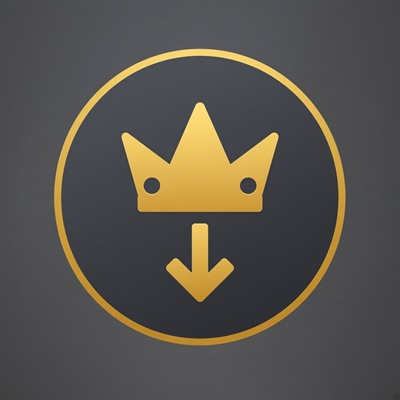
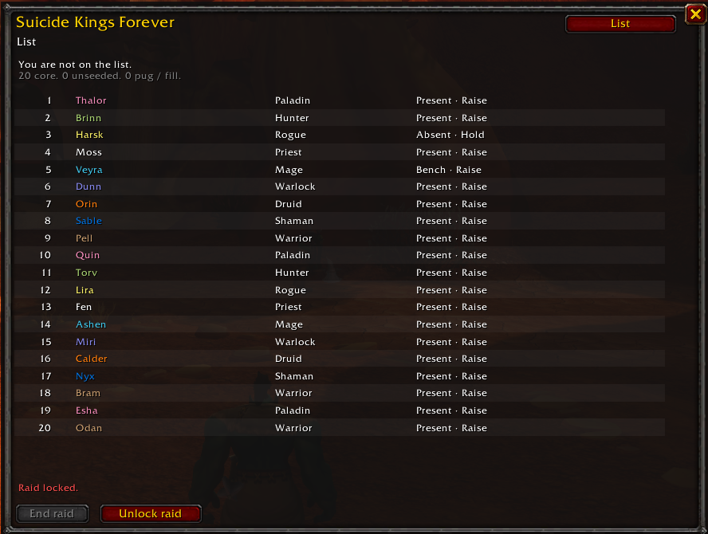
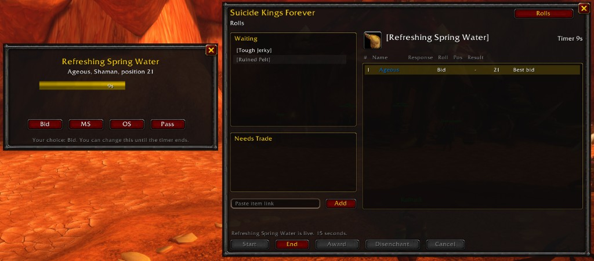

Suicide Kings Forever is a WoW Forever loot addon that keeps multiple Suicide Kings lists, reconciles who is in the raid, and runs timed rolls for the officer.

## Features

- Multiple lists, with seeding for raiders who do not have a position yet
- Reconcile: Present, Bench, Absent, No-call/no-show, and Pug/fill
- Bid, MS, OS, hold, and raise
- A roll timer, a raider popup, and chat rolls without the addon
- Unseeded bids `/roll 100`; the highest roll wins
- Visible `/roll 100` bids and plus counts when a pug is in the raid
- Award by master loot or trade
- Disenchant to an assigned disenchanter
- Award history and Discord export
- List import and export
- Gargul compatibility
- A minimap button

## Screenshots





## Usage

Install the `SuicideKingsForever` folder in `Interface\AddOns` and `/reload`. Commands are `/sk`, `/skf`, and `/suicidekings`.

The officer is the master looter when loot is set to master looter. Otherwise the officer is the raid or party leader. Out of a group, you are the officer. Raiders see List, History, and Settings. The officer also sees Import and Rolls.

### List and reconcile

`/sk` opens List. Before the raid is locked, the officer sees reconcile controls on that same window. After lock, or for anyone who is not the officer, it is the read-only list.

Set a status for each person before Lock raid. Status sets the default rolls and whether a later bid can raise them. Rolls and the raise/hold checkbox can still be changed before lock. Changing status resets those defaults. Changing rolls or the checkbox does not change status.

- Present: Bid, MS, OS, and allow raise
- Bench: cannot roll, and allow raise
- Absent: cannot roll, and hold
- No-call/no-show: cannot roll, swap one stored position down, then hold. Last place stays last
- Pug/fill on a core raider: MS and OS, hold, and they keep their stored position

Add with the Pug/fill checkbox for a true fill. They sit at the bottom for this raid and leave the list at End raid. History keeps their events.

Current Pos is the position when this reconcile pass started. New Pos is the live position and turns gold when it differs. Lock raid fills names and classes from the raid roster, then writes one history row per person.

A core raider who joins after lock gets an officer-only popup. Yes lets them bid and roll. No leaves them ineligible. Someone who was in the raid at lock and reconnects is not a late join.

### Import and export

Import takes Position, Name, and Class. Tabs or commas both work. A blank position is unseeded. A fully numbered list skips seeding. Merge with blank positions adds new names at the bottom of a list that already has positions. Replace with no positions starts seeding.

Export selects a Discord code block, including the ` ``` ` lines. Ctrl+C copies it. `sample-roster.csv` is a numbered 20-person example.

### Rolls

Open Rolls with `/sk rolls`, the dropdown, or Alt-left click an item in loot, a bag, a chat link, or the minimap button. Select a Waiting item and press Start. One item is live at a time. Start uses the timer from Settings. Changing the timer does not change an item that is already live.

Raiders with the addon get a popup for the choices their locked rolls allow. Anyone can say `bid` in chat, `/roll 100` for MS, or `/roll 99` for OS. A popup choice replaces chat from the same person. Chat does not announce list positions.

On a seeded list, one Bid beats every roll. The best stored position among bidders wins and spends that position. Bid drop, set in Settings, puts the winner in last place or immediately below the lowest other bidder. A sole bidder goes last. People set to hold keep their position.

Unseeded players may Bid. An unseeded Bid rolls `/roll 100`, and the highest of those rolls wins. A tie opens a roll-off with Roll or Pass. Roll does `/roll 100` in chat. An unseeded win inserts the winner at the bottom.

Award, Disenchant, and Cancel are on the live item. Award gives the item with master loot when that method is on and the item is still in a loot slot. Otherwise it goes to Needs Trade and the winner is asked to open trade. Disenchant also goes to Needs Trade and whispers the assigned disenchanter. The list does not move.

The book button on Rolls opens Award history beside that window. Click it again to close.

### Pugs

When a pug is in the raid, every bid and every main spec is a `/roll 100` so the pug can see the numbers, and off spec stays `/roll 99`. A bid is the word Bid in chat. If the pug rolls the highest 100, the pug wins the item and gains one plus. If a core raider rolls highest, or wins a tie in a roll-off against the pug, Suicide Kings chooses which core raider gets it, and that raider also gains a plus. A pug who already has a plus sits out while anyone at plus zero, or any core bid or main spec, is on the item. The core winner still gains a plus even when the pug does not roll, and every plus count clears at the end of the raid.

A true pug does not join the list. A core raider whose status was set to Pug/fill stays a core raider, and their presence still turns this mode on.

### History

History appends loot, reconcile, and late-join events. Award history shows bid position or the winning MS, OS, or unseeded roll. Export selects every event as a Discord code block. Import / Merge adds events whose id is not already saved and deletes nothing. It does not send those old events to the raid. Clear history is local to this character.

### Gargul

If Gargul is also installed and you are made master looter, SKF asks whether this raid should run in Gargul or SKF. Raiders who have both follow that choice. When the master looter uses SKF, a raider who only has Gargul gets Gargul's roll window. MS and OS from that window show on the officer's Rolls window. Gargul's Pass button only closes its own window, so it does not appear as a pass.

Check Block Gargul roll window on Rolls so Alt-left click adds the item to SKF without opening Gargul. That block clears at the end of the raid.

### Settings

Settings is on the dropdown for everyone, after History. `/sk settings` opens it. Bid drop, the timer, the countdown, the disenchanter, auto add, boss loot announce, status defaults, end raid, and clear list stay with the officer. Background opacity, the minimap button, window positions, and clear history stay on this character.

- Bid drop: last place, or immediately below the lowest other bidder
- Roll timer, default 15 seconds, and countdown, default 5 seconds
- Disenchanter, saved across sessions
- Auto add items when you are master looter, with a quality threshold
- Announce Boss Loot in Raid Chat, one item per line, using that same quality filter
- Show minimap button. Left-click opens List, right-click opens the window menu, Alt-left click adds an item
- Background opacity for every SKF window on this character. It is not sent to the raid
- Reset all settings restores those values and window positions. It does not clear the list or history
- Clear list asks for confirmation and is refused while the raid is locked
